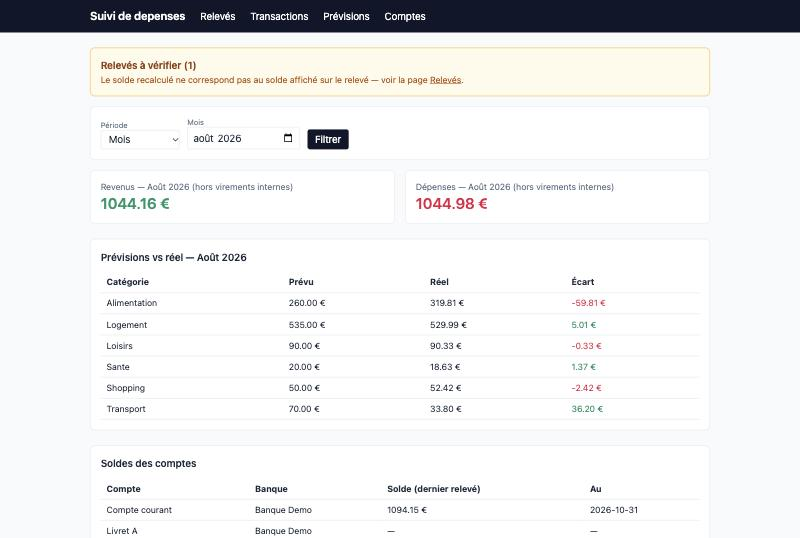
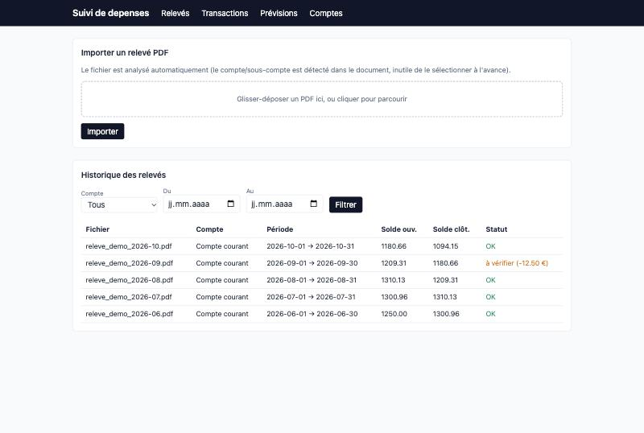
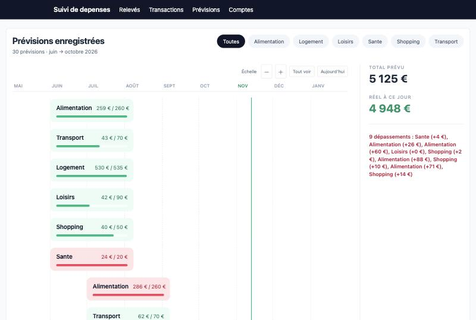

# LLM bank-statement tracker

**A local web app that turns raw PDF bank statements into a categorized ledger with a large language model, checks every extraction against the printed balances, and compares actual spending with the budget.**

*[Version française](README.fr.md) · the user interface is in French.*



*All screenshots use a fictional demo database (`scripts/seed_demo.py`).*

## Why

French bank statements are PDFs with irregular layouts. Some transactions span several lines, debit and credit columns are only separated by position, and one document can contain several accounts (checking plus savings). Rule-based parsers break with every new layout. This app treats extraction as a **structured-output problem for an LLM**, then **verifies the output with accounting arithmetic** before anything reaches the database.

## How it works

```
PDF ──► pdfplumber (text + raw column table)
          │
          ▼
     LLM extraction ── JSON schema (tool use / structured output)
     Claude API  or  Ollama (local, free)
          │
          ▼
     Validation ── balance reconciliation: opening + credits − debits = closing?
          │          malformed-output recovery, retries
          ▼
     SQLite (one atomic transaction per statement) ──► dashboard, budgets, refunds
```

| Concern | What the app does |
|---|---|
| **Structured extraction** | One JSON schema serves as the Anthropic tool definition and as the Ollama `format` constraint. The model must return accounts, balances and typed transactions (date, amount, direction, merchant, category, internal-transfer flag). |
| **Grounding against hallucination** | The prompt forbids inferring debit or credit from wording. It points the model to the raw column table extracted from the PDF instead. |
| **Automatic verification** | Every imported statement is **reconciled**: the computed closing balance must match the printed one to within €0.01. A mismatch flags the statement for review (see the screenshots). It catches dropped transactions and swapped debit/credit, the typical failures of small models. |
| **Robustness** | Recovers responses where the model nests JSON inside a string. Retries non-deterministic failures. Re-importing a statement is idempotent, thanks to file hashes and deduplication keys. |
| **Learning from corrections** | When the user changes a category, the app remembers it for that merchant, and the correction overrides the LLM's guess on later imports. |
| **Data safety** | Each import runs as one atomic database transaction. Automatic SQLite backups are taken before imports and after edits. A pre-push check (`scripts/check_no_personal_data.py`) scans committed files for identifiers taken from the local database, plus IBANs and API keys. |

## Features

- Drag-and-drop PDF import. Accounts and sub-accounts are detected from the document.
- Transactions table with inline editing that saves automatically (there is no "Save" button) and an *internal transfer* flag.
- Refund allocation: a credit, such as a friend repaying their share of a dinner, can be assigned to one or more expenses. Budgets then use the net amount.
- Budgets by category over any period, prorated to the days viewed, shown as a timeline with overruns.

| Statements and reconciliation status | Budget timeline |
|---|---|
|  |  |

## Quickstart

```bash
python3 -m venv .venv && source .venv/bin/activate
pip install -r requirements.txt
cp .env.example .env            # choose EXTRACTION_BACKEND=claude (API key) or ollama (local)

# Try it with fictional data, without importing any real statement:
SUIVI_DATA_DIR=demo_data python -m scripts.seed_demo
SUIVI_DATA_DIR=demo_data uvicorn app.main:app      # http://127.0.0.1:8000

python -m pytest -q                                 # 41 tests
```

## Choice of backend

| Backend | Cost | Privacy | Notes |
|---|---|---|---|
| Claude (`claude`) | ≈ €1 per year for two monthly statements | Extracted text is sent to the API | Most reliable on multi-line transactions and internal-transfer detection |
| Ollama (`ollama`, e.g. `llama3.2:3b`) | Free | Nothing leaves the machine | Less accurate; the reconciliation check flags its errors |

## Stack

Python · FastAPI · SQLModel / SQLite (WAL) · Jinja2 · pdfplumber · Anthropic API (tool use) · Ollama (structured outputs) · pytest

## Limitations and next steps

- **No quantitative extraction benchmark yet.** Next step: generate synthetic statements with known ground truth, then measure field-level accuracy and reconciliation pass rate for each backend and model.
- The UI and prompts are in French and were tuned on two French banks.
- The app is designed for a single local user, not for multi-user deployment.

## License

MIT
